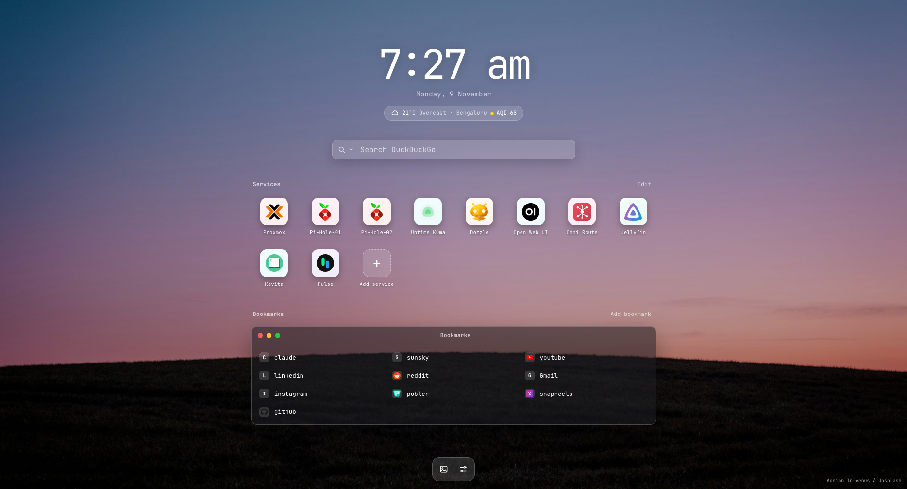

# Lantern

**A minimal, macOS-style start page for your homelab.** Add your services as app-icon tiles, keep your bookmarks, search the web, check the weather and air quality, and pick a wallpaper. It is a tiny self-hosted app with no database and no npm dependencies. It runs in one small container.



## Features

- **Service tiles.** App-style icons for your homelab services, added and edited from the page itself. Click **Edit** and the tiles wiggle, like on iOS.
- **Bookmarks.** A frosted-glass window of links. You can hide the URL text if you prefer a cleaner list.
- **Icon picker** for services and bookmarks. Choose Auto (favicon), one of 180 bundled app logos (searchable, works offline), an emoji, or your own image URL or glyph.
- **Search.** DuckDuckGo by default, with a switcher for Google, Brave, Startpage, Kagi, Ecosia, Bing, or your own SearXNG address. Press `/` anywhere to focus the box.
- **Weather and air quality.** Powered by [Open-Meteo](https://open-meteo.com/), so no API key is needed. It shows current conditions, a 5-day forecast, and the US or European AQI with PM2.5 and PM10.
- **Wallpapers.**
  - 9 built-in wallpapers that work with no setup.
  - Random photos from **Pexels** or **Unsplash** (bring your own free API key).
  - Your own uploads (up to 10, resized to 2560 px wide).
  - A history of the last few fetched photos that you can reuse or download.
- **Make it yours.** Gradient presets or custom colours, font choice (JetBrainsMono Nerd Font is bundled), 12/24-hour clock with optional seconds, optional date, and toggles for the search bar, weather, services, bookmarks and bookmark URLs.
- **Backup.** Export and import your services, bookmarks and settings as a JSON file (API keys are left out of exports).

## Quick start

### Docker

```sh
git clone https://github.com/<your-username>/lantern.git
cd lantern
docker compose up -d --build
```

Open <http://localhost:3000>.

### Podman (rootless)

```sh
mkdir -p data
podman compose -f podman-compose.yml up -d --build
```

Without a compose provider:

```sh
podman build -t lantern .
podman run -d --name lantern --restart unless-stopped \
  -p 3000:3000 -v ./data:/data:Z,U localhost/lantern
```

### Without a container

Needs Node.js 18 or newer. There is nothing to install.

```sh
node server.js          # data is stored in ./data
```

## Configuration

Everything is configured from the **Settings** sheet (the sliders icon in the dock). A few things can also be set with environment variables:

| Variable | Default | Purpose |
|---|---|---|
| `PORT` | `3000` | Port the server listens on |
| `DATA_DIR` | `./data` (`/data` in the container) | Where your data is stored |
| `PEXELS_API_KEY` | none | Pexels key (you can enter it in Settings instead) |
| `UNSPLASH_ACCESS_KEY` | none | Unsplash **Access Key** (the Secret Key is not used) |
| `WALLPAPER_HISTORY` | `8` | How many recently fetched Pexels/Unsplash wallpapers to keep |

### Where your data lives

```
data/
├── data.json          services, bookmarks and settings (API keys are stored here in plain text)
└── wallpapers/        your uploads and recently fetched photos, plus index.json
```

Back up the whole `data/` folder.

## Troubleshooting

- **Podman fails with `/dev/net/tun` or a `pasta` error** (common inside LXC containers). Build with `--network=none` and run with `--network=host`. [`compose.host-network.yml`](compose.host-network.yml) does exactly that.
- **Port 80 as a non-root user.** Either run the container as root (see the file above) or keep a high port and put a reverse proxy in front.
- **"Permission denied" writing to `./data`.** Use `:Z,U` on the volume (Podman), or `chown 1000:1000 data` (Docker bind mounts).
- **No weather, or wallpapers don't fetch.** The server itself needs internet access for these.

## Security

Lantern has **no login**. Anyone who can reach it can change your services and read the API keys stored in `data.json`. Keep it on your LAN, or put it behind a reverse proxy that adds authentication (Caddy, Authelia, Authentik and so on).

## Project layout

```
server.js              tiny dependency-free Node server and JSON API
web/
  index.html           the page and its styles
  app.js               all front-end logic
  api.js               small client for the JSON API
  fonts/ icons/ wallpapers/
tools/
  generate-wallpapers.py   regenerates the built-in wallpapers
Dockerfile, *compose*.yml
```

The server exposes a small JSON API under `/api` (`data`, `wallpaper`, `library`, `upload`, `weather`, `geocode`) and serves uploaded and fetched images from `/media`.

## Roadmap

Ideas, in rough order: status dots that show whether each service is up, type-to-launch filtering, drag-to-reorder, bookmark groups, importing browser bookmarks, a light theme, and an optional edit lock.

## Credits and licenses

Lantern is released under the [MIT License](LICENSE). Bundled fonts, icons and data sources have their own terms. See [THIRD_PARTY.md](THIRD_PARTY.md).

Weather and air quality data by [Open-Meteo.com](https://open-meteo.com/).
